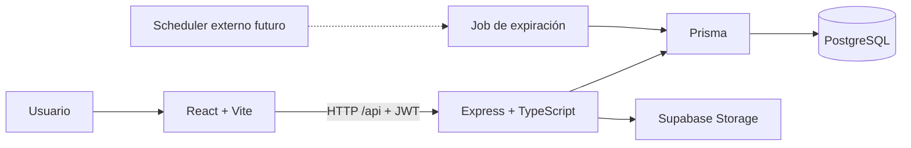

# Arquitectura general

El sistema es una aplicación web con frontend React/Vite, API HTTP Express en TypeScript y PostgreSQL administrado mediante Prisma. El backend concentra autenticación, validaciones, autorización, reglas de negocio e integración de archivos. Las expiraciones de promociones, reservas y prioridades corren en un proceso job aparte, no en el servidor HTTP.

## Módulos principales

- Frontend: rutas, autenticación, RBAC de UI, páginas y componentes reutilizables.
- API: autenticación, lotes, reservas, ventas/pagos, personas, inmobiliarias, prioridades, archivos, fracciones y ubicaciones (solo lectura). 78 operaciones `/api` más `GET /health`.
- Persistencia: Prisma sobre PostgreSQL.
- Archivos: integración backend con Supabase.

## Decisiones relevantes

- Arranque productivo del backend: `npm ci` → `npm run build` → `node dist/server.js` (imagen Docker multi-stage, stage `runtime`). Desarrollo local: `npm run dev` (también en `docker-compose.yml`, que usa el stage `deps`); no es el runtime productivo. El proceso web no ejecuta expiraciones.
- Job de expiración one-shot: `npm run jobs:expirations:prod` (`dist/jobs/runExpirations.js`). El scheduler que lo dispare es infraestructura futura, no un recurso desplegado hoy.
- Liveness: `GET /health` → `200 {"status":"ok"}`. Cierre ordenado ante `SIGTERM`/`SIGINT` (drain HTTP, Prisma).
- Backend separado en rutas, controladores, servicios, validaciones y middleware.
- Frontend separado en páginas, componentes, `lib/api`, hooks y utilidades.
- Autenticación Bearer JWT (sin cookies, sin refresh); rol e inmobiliaria se releen de la DB en cada request. Autorización por rol en el backend, reflejada en la UI.
- Contrato de errores único `{ success: false, code, message, errors? }`.
- Eliminación lógica para preservar trazabilidad.

## Riesgos y pendientes

- CORS es fail-closed: allowlist de un origin (`FRONTEND_URL`) con matching exacto; ver `docs/architecture/backend.md`.
- `Documentacion/` sigue siendo la fuente histórica; decisiones no inferibles del código requieren validación del equipo.
- `Backend/documents/documentacionApi.yaml` es el contrato de la API (79 operaciones). Un test compara la OpenAPI con las rutas reales, su seguridad y sus roles.
- Lo que queda para el checkpoint Cloud y la deuda post-Cloud: `docs/architecture/freeze-pre-cloud.md`.
